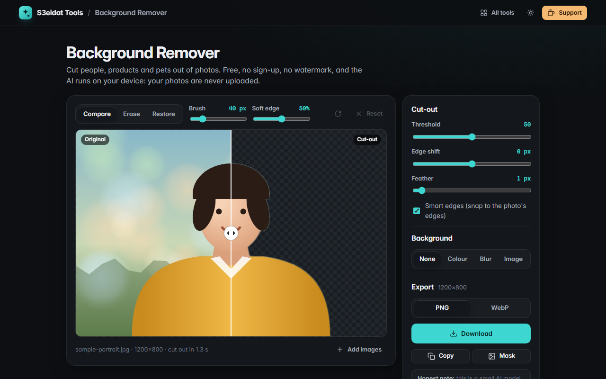

# Background Remover

> Remove image backgrounds free, on your device. A private alternative to paid background removers: the AI runs in your browser and your photos are never uploaded.

### ▶ [Open Background Remover](https://s3eidat.github.io/bg-remover/)



## Features

- **AI cut-out** with U²-Net small, running locally through onnxruntime-web (WebAssembly)
- **Instant before/after**: drag the compare line over the result
- **Refine brush**: Erase and Restore with adjustable size and soft edge, undo, reset
- **Threshold, edge shift and feather** sliders, plus **smart edges** that snap the mask to the photo's own edges
- **Backgrounds**: transparent, any colour, a blurred version of the original (the subject's colours are kept out of the blur), or your own image
- **Full-resolution export** as PNG or WebP, copy to clipboard, or save the black-and-white mask
- **Batch**: drop many photos, they are processed one after another; download them all as a `.zip`
- Paste from the clipboard, keyboard shortcuts (`C` compare, `E` erase, `R` restore, `[` `]` brush size, `Ctrl+Z` undo)
- Works offline after the first visit

## How it works

The photo is resized to 320×320 and normalised with the ImageNet mean/std, then U²-Net small predicts a saliency
mask. The mask is min-max normalised, upscaled to the photo's size with bilinear smoothing, refined with a guided
filter, and shaped by your threshold / edge / feather settings. Brush strokes are stored as vectors and redrawn at
full resolution when you export.

## Honest limits

- It is a **small** model (4.4 MB). It does well on a clear subject (people, products, pets) and less well on
  fine hair, fur, glass, smoke, or photos with several subjects. Use Erase and Restore to fix those.
- The mask is predicted at 320×320 and then refined, so very fine detail in large photos is approximate.
- Huge images are scaled down to stay inside the browser's canvas limit (about 36 megapixels).
- Heavy photos take a second or two each, on your own processor.

## Privacy

Your photos never leave your device. There is no server, no account, no analytics.
The first time you use it, your browser downloads the AI engine and model (about 16 MB) **from this same site**;
after that they are cached and it works offline. The page ships with a strict Content-Security-Policy
(`connect-src 'self'`), so the browser itself blocks any attempt to send data anywhere. `'wasm-unsafe-eval'` is
allowed only so the browser can compile the WebAssembly engine; JavaScript `eval` stays blocked.

## Credits

- **U²-Net** (small, `u2netp`) by Xuebin Qin et al., *"U²-Net: Going Deeper with Nested U-Structure for Salient
  Object Detection"*, Pattern Recognition 2020. Apache-2.0. ONNX export from the rembg project. See `models/LICENSES.md`.
- **ONNX Runtime Web** by Microsoft, MIT licence. See `lib/ort.LICENSE`.

## Run it yourself

It's plain HTML, CSS and JavaScript with no build step:

```bash
git clone https://github.com/s3eidat/bg-remover
cd bg-remover
python -m http.server 8000
```

Then open http://localhost:8000.

## Support

If this saved you time, **[buy me a coffee ☕](https://s3eidat.github.io/coffee/)**. It keeps every tool free.

---

Part of **[S3eidat Tools](https://s3eidat.github.io/)**: 100+ free, private tools that run in your browser. MIT licensed.
